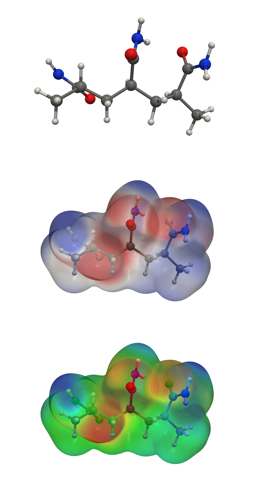

# esp-figure

Publication-quality molecule figures — ball-and-stick structures and
electrostatic potential (ESP) maps — **using only free software**.

Made for researchers on a limited budget who need a figure of the chemical
structure they work with for a paper or thesis, but don't have access to
paid packages like Gaussian + GaussView. One command does the quantum
chemistry; a second makes the images in seconds.



*Polyacrylamide trimer: structure, ESP (red-white-blue), ESP (rainbow).
Red = negative, blue = positive.*

## Install

Needs Python 3.10+ on Linux or macOS. **On Windows, use WSL** (PySCF does not
run natively on Windows): `wsl --install -d Ubuntu`, then do the rest inside Ubuntu.

```bash
sudo apt install -y python3-venv libgl1 libxrender1      # Ubuntu/WSL only
python3 -m venv ~/esp-venv && source ~/esp-venv/bin/activate
pip install --prefer-binary pyscf rdkit pyvista vtk matplotlib pillow geometric
python test_water.py                                     # should print "ok"
```

## Use

```bash
# 1. Chemistry (minutes). Input: a SMILES string or an .xyz file.
python esp_figure.py calc "CC(C(N)=O)CC(C(N)=O)CC(C)C(N)=O" --name pam3

# 2. Figures (seconds). Re-run freely to change the look.
python esp_figure.py render pam3 [--style rwb|rainbow|both] [--limit 0.06] [--view=x,y,z]
```

Results go to `runs/<name>/`: `ball.png`, `rainbow_esp.png`, `rwb_esp.png`,
and **`caption.txt`**, which holds the method details (level of theory, surface,
colour limits, software versions) and a ready-to-use caption sentence.

For final figures, add `--opt` to `calc` to optimise the geometry with DFT
first (30–60 min for ~35 atoms). Without it, the geometry is a quick
force-field draft.

## Method

| Step | Choice |
|---|---|
| Geometry | Lowest of 50 RDKit conformers by MMFF94 (draft), or then B3LYP/6-31G(d) with `--opt` |
| Electronic structure | PySCF, B3LYP/6-31G(d), density fitting |
| Surface | Electron density isosurface, ρ = 0.001 a.u. |
| ESP | Computed exactly at each surface vertex |
| Rendering | PyVista, 1600×1000 PNG |

To compare molecules, render them all with the same `--limit`.

## Limitations — read before publishing

- **Gas-phase conformer.** SMILES input is embedded as 50 conformers and the
  lowest MMFF94 energy one is used. In the gas phase that tends to be a folded
  shape with internal hydrogen bonds, which may not match the molecule in
  solution or in a solid. If that matters, supply your own `.xyz` geometry.
- **Closed-shell, neutral or charged molecules only** — no radicals.
- **Fixed level of theory** (B3LYP/6-31G(d)): standard for figures like
  these, but not suitable for quantitative energetics.
- Large molecules (≳100 atoms) get slow and the surface may look faceted.

## Citing

If you use this in a paper, please cite the software that does the real work:
[PySCF](https://pyscf.org/about.html#how-to-cite),
[RDKit](https://www.rdkit.org),
[PyVista](https://docs.pyvista.org/getting-started/authors.html#citing-pyvista),
and [geomeTRIC](https://github.com/leeping/geomeTRIC) if you used `--opt`.

## License

MIT — see [LICENSE](LICENSE).
