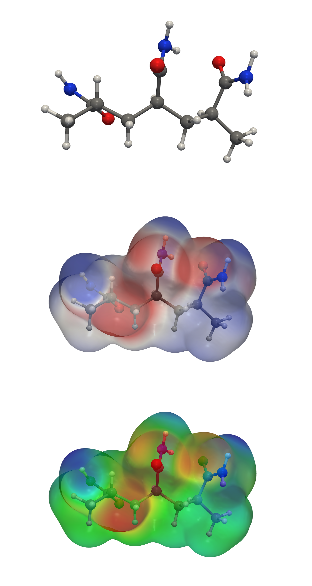

# esp-figure

Publication-quality molecule figures — ball-and-stick structures and
electrostatic potential (ESP) maps — **using only free software**.

Made for researchers on a limited budget who need a figure of the chemical
structure they work with for a paper or thesis, but don't have access to
paid packages like Gaussian + GaussView. One command does the quantum
chemistry; a second makes the images in seconds.



*Polyacrylamide trimer: structure, ESP (red-white-blue), ESP (rainbow).
Red = negative, blue = positive.*

## Install

Everything is free and comes from `pip`; nothing else has to be downloaded by hand.
Needs Python 3.10+ on Linux or macOS. **On Windows, use WSL** (PySCF does not run
natively on Windows): `wsl --install -d Ubuntu` in an admin PowerShell, reboot, then
do the rest inside Ubuntu.

```bash
git clone https://github.com/Fliporama/esp-figure.git && cd esp-figure
sudo apt install -y python3-venv libgl1 libxrender1      # Ubuntu/WSL only
python3 -m venv ~/esp-venv && source ~/esp-venv/bin/activate
pip install --prefer-binary pyscf rdkit pyvista vtk matplotlib pillow geometric pyscf-dispersion
python test_water.py                                     # ~1 min, should print "ok"
```

`geometric` is needed for `--opt`, `pyscf-dispersion` for `--d3`. Rendering is
offscreen, so no display is needed (a harmless `bad X server connection` warning may print).

**Big machines:** PySCF uses all cores and, by default, at most 4 GB of RAM (the rest goes
to scratch files, which is slow). For large jobs such as `--freq`, raise the limit
(in MB) and put scratch on a large local disk:

```bash
export PYSCF_MAX_MEMORY=64000          # e.g. 64 GB
export PYSCF_TMPDIR=/path/to/big/disk  # default ~/.cache/esp-scratch
```

## Use

```bash
# 1. Chemistry (minutes). Input: a SMILES string or an .xyz file.
python esp_figure.py calc "C[C@@H](C(N)=O)C[C@H](C(N)=O)C[C@H](C)C(N)=O" --name pam3s

# 2. Figures (seconds). Re-run freely to change the look.
python esp_figure.py render pam3s [--style rwb|rainbow|both] [--limit 0.06,0.03] [--view=x,y,z|auto]
```

The example is a syndiotactic polyacrylamide trimer (~3 min on a laptop).
**Stereocentres must be specified** (`@`/`@@`): a SMILES like `CC(C(N)=O)CC(C(N)=O)CC(C)C(N)=O`
is refused, because RDKit would give every conformer a random configuration, and the
"lowest-energy conformer" would then compare different molecules.

Results go to `runs/<name>/`: `ball.png`, `rainbow_esp.png`, `rwb_esp.png`,
`method.txt` (level of theory, surface, colour limits, software versions, energies)
and, after `render`, `caption.txt` with a ready-to-use caption sentence.
`runs/` is not part of the repository: copy run folders yourself to move results
between machines.

For final figures, add `--opt` to `calc` to optimise the geometry with DFT
first (30–60 min for ~35 atoms). Without it, the geometry is a quick
force-field draft.

### Options

`calc` (run `python esp_figure.py calc -h` for details):

| Option | What it does |
|---|---|
| `--opt` | DFT geometry optimisation (geomeTRIC); `--opt-conv qchem` for floppy chains. Restarts from `opt_traj.xyz` if interrupted |
| `--d3` | D3(BJ) dispersion; changes energies, not the ESP |
| `--solvent water` | implicit water (IEF-PCM) for the SCF, the optimisation and the ESP |
| `--rerank N` | DFT single points on the N lowest force-field conformers; continue with the lowest |
| `--no-hbond` | start from the lowest conformer without an internal H-bond (extended shapes) |
| `--freq` | harmonic frequencies; 0 imaginary = true minimum (slow: hours and ~10 GB RAM for 35 atoms) |
| `--orbitals` | HOMO/LUMO surfaces and energies |
| `--charges mk\|chelpg` | ESP-fitted atomic charges → `charges.txt` |
| `--nci` (`--nci-step 0.1`) | non-covalent interaction (RDG) plot → `nci.png` |
| `--fukui` | condensed Fukui functions f+/f− → `fukui.txt` |
| `--spin N` | open-shell molecules (UKS), `.xyz` input only |
| `--charge Q` | total charge for `.xyz` input |

Elements with Z > 36 (e.g. I) are supported from `.xyz` input with def2-SVP + ECP on
those atoms only.

`render`: `--extrema` marks the ESP minimum and maximum, `--hbonds` draws H-bonds as
dashed lines, `--view auto` picks a camera direction.
`panel A B --labels a,b` puts several rendered runs side by side with one shared colour bar.

## Method

| Step | Choice |
|---|---|
| Geometry | Lowest of 50 RDKit conformers by MMFF94 (draft), or then B3LYP/6-31G(d) with `--opt` |
| Electronic structure | PySCF, B3LYP/6-31G(d), density fitting (optionally + D3(BJ), + PCM water) |
| Surface | Electron density isosurface, ρ = 0.001 a.u. |
| ESP | Computed exactly at each surface vertex |
| Rendering | PyVista, 1600×1000 PNG |

To compare molecules, render them all with the same `--limit`. Red is always
negative ESP, blue positive.

## Limitations — read before publishing

- **One conformer.** SMILES input is embedded as 50 conformers and the
  lowest MMFF94 energy one is used. In the gas phase that tends to be a folded
  shape with internal hydrogen bonds, which may not match the molecule in
  solution or in a solid. `--solvent water`, `--rerank` and `--no-hbond` help;
  for long flexible chains, build the shape you mean and supply it as `.xyz`.
- **Fixed level of theory** (B3LYP/6-31G(d), 5 spherical d functions): standard for
  figures like these. Energy differences of a few kcal/mol between conformers are
  within its error. Gaussian uses 6 Cartesian d functions by default, so absolute
  energies differ slightly from Gaussian's.
- **Laptop-sized.** ~35 atoms: minutes per single point, about an hour per optimisation,
  hours for frequencies. Large molecules (≳100 atoms) get slow and the surface may look faceted.
- Not validated against a Gaussian reference calculation yet.

## Citing

If you use this in a paper, please cite the software that does the real work:
[PySCF](https://pyscf.org/about.html#how-to-cite),
[RDKit](https://www.rdkit.org),
[PyVista](https://docs.pyvista.org/getting-started/authors.html#citing-pyvista),
[geomeTRIC](https://github.com/leeping/geomeTRIC) if you used `--opt`,
and [simple-dftd3](https://github.com/dftd3/simple-dftd3) if you used `--d3`.

## License

MIT — see [LICENSE](LICENSE).
